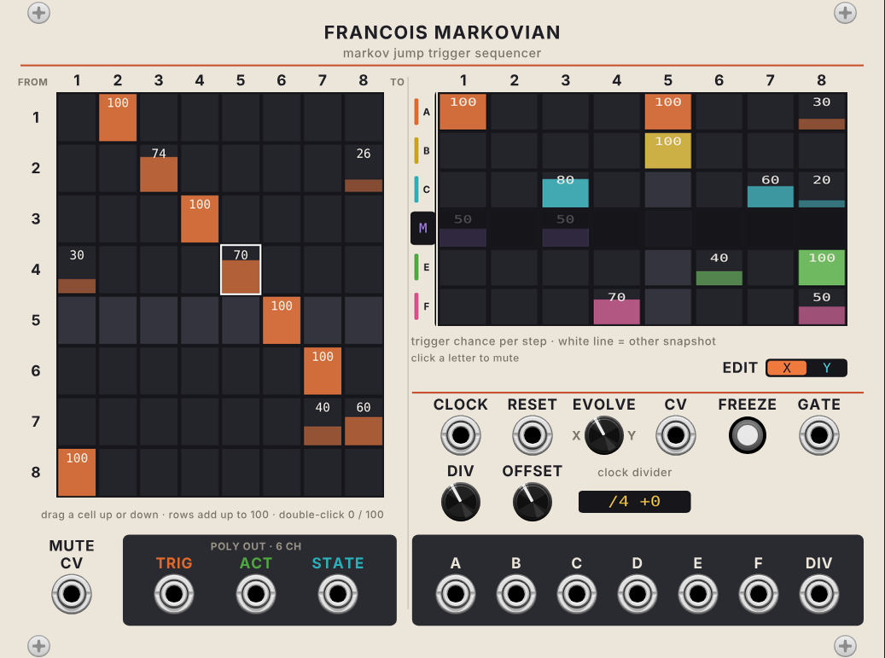
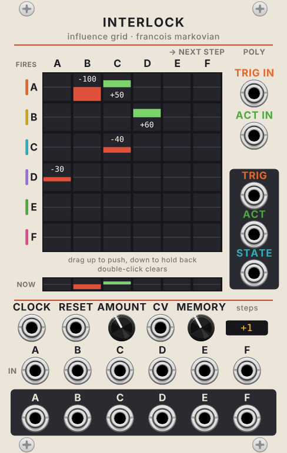
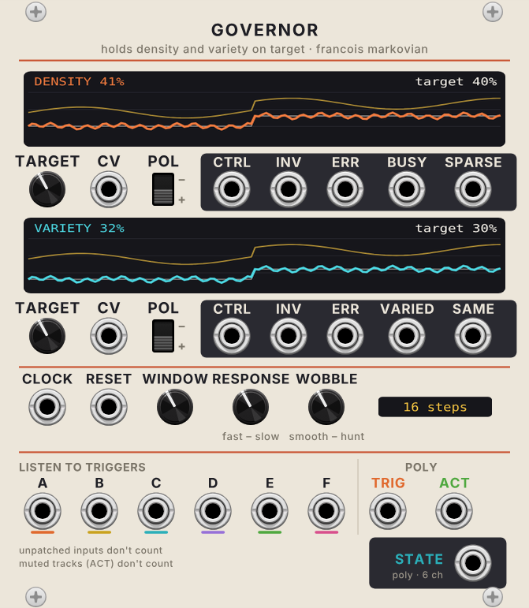
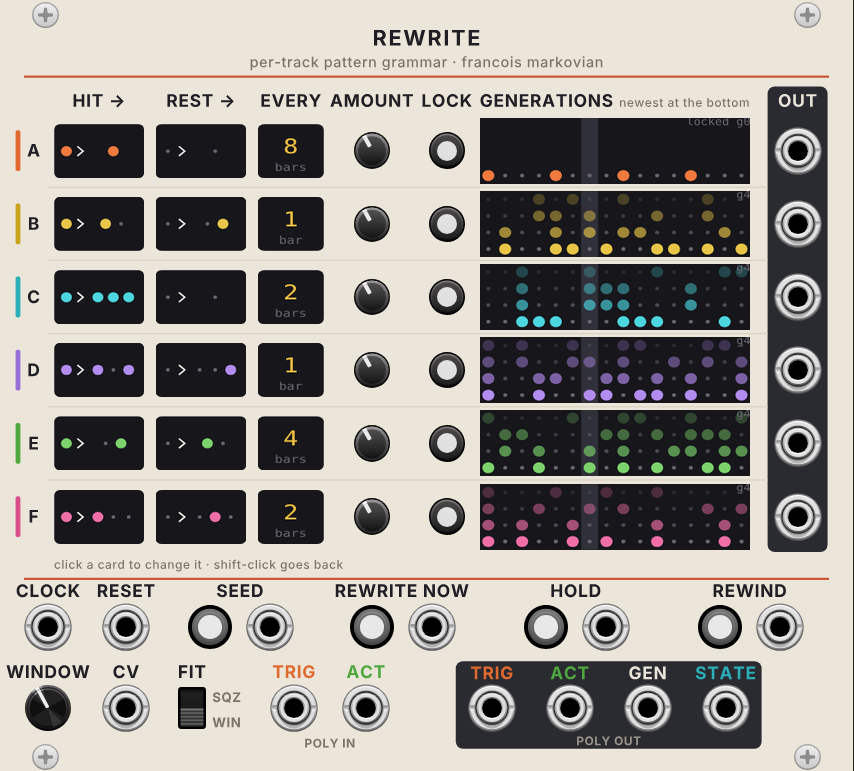

# Francois Markovian

A VCV Rack 2 plugin with four modules: **Francois Markovian**, a Markov jump
trigger sequencer; **Interlock**, an influence-grid trigger processor;
**Governor**, a feedback controller that holds density and variety on target;
and **Rewrite**, which grows each track's pattern by its own rules (see below).
Since 3.0 they link with three kinds of **poly cable** (see *Linking with poly cables*).

## Francois Markovian

A trigger sequencer (34 HP). One playhead walks an 8-step pattern
with six trigger tracks, **A to F**. On every clock pulse it picks its next step
from a hand-set **jump matrix**, then each track rolls its own chance for the
step it lands on. The pattern stays recognisable but gets reshuffled, like a
drummer skipping around the bar.

## The jump matrix (left)

Each **row** is the step the playhead is on (FROM), and each **column** is a
step it can go to (TO). Every cell shows its chance as a number and as a bar,
and **each row always adds up to 100**.

- **Drag a cell up or down** to set its chance. The rest of the row rescales to
  make room and keeps its own balance: with 30 / 70 in a row, dragging a third
  cell to 50 leaves 15 / 35 / 50. Hold Shift for fine control.
- **Double-click** a cell to switch it between 0 and 100.
- Lowering a row's only cell spreads the rest evenly over the other cells.
- A new module plays **straight** (each step goes to the next).
- The **diagonal** (a step going to itself) gives stutters and rolls.
- An empty row (after double-clicking its only cell to 0) falls back to the
  next step, shown as a small outline.
- The lighter row is where the playhead is now, and the white outline shows the jump it just took.

## Trigger chances (right)

Each of the 6 × 8 cells is the chance (0 to 100) that the track fires when the
playhead lands on that step. Drag it up or down, or double-click it for 0 / 100.
The playhead's column is lighter, and a cell flashes when it fires.

A new module starts with **A on step 1** and **B on step 5**, both at 100.

## Snapshots X and Y, and Evolve

There are two snapshots, each with its own **matrix and trigger chances**. The
**EDIT X / Y** switch chooses which one the grids show and edit. A **white line**
in a cell marks the other snapshot's value there.

**EVOLVE** (knob plus CV, 0 to 10 V adds 0 to 100%) blends every matrix cell and
every trigger chance from X to Y. A trigger at 0 in X and 100 in Y fires half the
time at the halfway point. The white tick under the X / Y switch shows where
Evolve is.

## Freeze

The **FREEZE** button (toggle) or **GATE** input (freezes while high) loops the
**last 8 steps exactly as they were played**, steps and triggers, dice and all.
Release it and the playhead carries on from where it is. Reset while frozen
restarts the loop from its start.

## Clock divider

**DIV** (1, 2, 4, 8, 16) and **OFFSET** (0, 1, 2, 4 pulses) set the **DIV** output:
a trigger on every Nth input clock, counted from Reset and shifted later by
the offset. The readout shows both, e.g. `/4 +2` fires on clocks 3, 7, 11 and so on.
It follows the input clock, not the jumping playhead, so it stays on the grid
for syncing other gear.

## Jacks

| Jack | What it does |
|---|---|
| **CLOCK** | Each pulse moves the playhead once |
| **RESET** | The next clock plays step 1 and restarts the divider count |
| **CV** | Evolve CV, added to the knob |
| **GATE** | Freeze gate |
| **A to F** | 5 ms triggers, 10 V |
| **DIV** | Divided clock, 5 ms triggers |
| **MUTE CV** | Poly: channel 1 = A ... 6 = F. 10 V mutes that track (on top of the buttons) |
| **TRIG** (poly out) | A to F on 6 channels |
| **ACT** (poly out) | 10 V for each playing track, 0 V for each muted one |
| **STATE** (poly out) | 1 step (0 V = step 1, 1 V a step), 2 Evolve (0 to 10 V), 3 freeze gate, 4 jump size (0 V = to the next step, ±1.25 V a step), 5 tracks fired (0 to 10 V), 6 phrase start (a trigger every 8 clocks from Reset) |

## Mutes

**Click a track's letter** (left of the trigger grid) to mute it: the letter turns
into a dark **M** and its row dims. A muted track still rolls its dice, so it
comes back in step when you unmute it. Mutes go out on **ACT**, so Interlock,
Rewrite and Governor all know the track is off.

## Right-click menu

- **Straight (step by step)**: reset the matrix of X, Y or both.
- **Randomise (nudge)**: small, controlled changes to the jump matrix of X or Y.
  *Gentle* moves 1 to 3 cells, *Wild* 1 to 5, each by 10 to 50 points; the
  touched rows rescale to 100 like a drag. Press it again to nudge further.
- **Copy X to Y / Copy Y to X**: copies the matrix and triggers. A good way to start Y as a variation of X.
- **Clear triggers**: for X, Y or both.

Everything is saved with the patch. Patches made with version 2.0 load with their
matrix and hits (as 0 / 100 chances) intact.

# Interlock

A 16 HP trigger processor that makes parts **answer each other**. Six triggers
come in (A to F) and six go out. Patch Francois Markovian's outputs into it, or
Seuperclidean's, or anything else.

## The influence grid

The 6 × 6 grid says "when track X fires, track Y's chance on the **next** step
changes by this much", from −100 to +100. The **row** is the track that fired,
and the **column** is the track that gets pushed.

On every step, each track's chance is:

- **100%** if a trigger came in, **0%** if not,
- plus the influences of every track that fired recently,
- kept between 0 and 100.

So a negative influence can **hold back** an incoming trigger, and a positive one
can add a **ghost hit** where nothing came in.

Example (right-click > *Load the guide's example*):

| Cell | Value | Effect |
|---|---|---|
| A → B | −100 | B can never play straight after A |
| A → C | +50 | C is pushed to play after A |
| C → C | −40 | C damps its own rolls (the diagonal is a track acting on itself) |
| B → D | +60 | D gets ghost hits after B |
| D → A | −30 | A is less likely after D |

**Drag** a cell up (green, push) or down (red, hold back). Shift drags finely,
and **double-click** clears a cell. A row's outline flashes when its track fires.
The **NOW** meters under the grid show how much each track is being pushed on the current step.

## Controls

| Control | What it does |
|---|---|
| **CLOCK** | Each pulse starts a step. Unpatched, the first incoming trigger of a step starts it |
| **RESET** | Clears the memory |
| **AMOUNT** + **CV** | Scales the whole grid. 0 = triggers pass straight through, 100% = as drawn. 0 to 10 V adds 0 to 100% |
| **MEMORY** | 0 = an influence lasts only the next step. 1 to 4 = it lasts that many extra steps, fading out evenly (memory 2: 100%, 67%, 33%) |
| **IN A to F** | Incoming triggers |
| **OUT A to F** | 5 ms triggers |
| **TRIG IN** (poly) | A to F in one cable. A mono IN jack replaces its channel. With it patched, channels that aren't there are tracks that don't exist |
| **ACT IN** (poly) | Muted tracks pass nothing, get no ghost hits and push nothing. Unpatched: all playing |
| **TRIG** (poly out) | A to F |
| **ACT** (poly out) | ACT IN passed on |
| **STATE** (poly out) | The NOW meter of each track, ±5 V |

Influences add up, so two tracks each pushing E by +50 give E a full 100%.

**Timing:** incoming triggers are passed on (or held back) the moment they arrive,
with no delay. Ghost hits are rolled 2 ms after the clock, so triggers coming
from another module (which reach Interlock a sample after the clock) count
before the ghosts are decided. Use the same clock for Interlock and the sequencer feeding it.

Right-click: Clear grid, Load the guide's example, Randomise.

# Governor

A 22 HP feedback controller. It **listens** to up to 6 trigger tracks, **measures**
how busy and how changeable they are, and outputs **control CVs** that push the
music back towards targets you set. Patch the CVs into whatever shapes the
pattern (Francois Markovian's EVOLVE, Interlock's AMOUNT, Seuperclidean's
density, a VCA...) and the system steers itself.

## What it measures

Over the last **WINDOW** clocks (8, 16, 32 or 64, default 16):

- **Density**: the share of possible hits that played, i.e. hits / (window × connected tracks).
- **Variety**: how different this window is from the window before it, step by
  step. 0% = an exact repeat, 100% = nothing in common. (It needs two full
  windows of history before it starts measuring.)

Only **connected** trigger inputs count (all six if none are patched). With the
poly **TRIG** input patched, its channels are the tracks. Tracks muted on the
poly **ACT** input drop out of both measurements, so muting the hats in a
breakdown doesn't make Governor pile hits onto the other tracks. If every track
is muted, the controls hold still.

The poly **STATE** output carries 1 density, 2 variety (0 to 10 V), 3 density
error, 4 variety error (±5 V), 5 density control and 6 variety control (0 to 10 V).

## The two loops

Each of density and variety has its own row:

| Control | What it does |
|---|---|
| **TARGET** + **CV** | The level to hold. 0 to 10 V adds 0 to 100%. Drive it from Live (CV Tools) to give each arrangement section its own energy |
| **POL** | Down (+): raising the control raises the measurement. Up (–): raising the control lowers it |
| **CTRL** | The control, 0 to 10 V |
| **INV** | The control upside down, 10 to 0 V |
| **ERR** | Target minus measured, ±5 V (positive = needs more) |
| **BUSY / SPARSE** | Gates while density is more than 5% above / below target |
| **VARIED / SAME** | Gates while variety is more than 5% above / below target |

## Shared controls

| Control | What it does |
|---|---|
| **CLOCK** | One pulse per step. Use the same clock as the sequencer |
| **RESET** | Clears the measurement history |
| **WINDOW** | 8, 16, 32 or 64 clocks |
| **RESPONSE** | How quickly the controls correct, from about 4 clocks (fast) to 256 (slow) |
| **WOBBLE** | Smooth (0) settles without overshoot. Towards full it pushes harder with less damping, so it **overshoots and hunts** around the target |

The graphs scroll one point per clock: the coloured line is the measurement,
the white line the target and the yellow line the control.

Right-click: *Centre both controls (5 V)*.

## Patch ideas

- **Energy per section:** Markovian A to F outs → Governor ins. Density CTRL →
  Markovian EVOLVE CV (make Y the busier snapshot). Automate density TARGET from Live.
- **Self-locking loop:** variety **VARIED** gate → Markovian **FREEZE** gate.
  When things get too chaotic it locks into a loop; once the loop is too repetitive
  (variety falls), the gate drops and it lets go again.
- **Interplay on demand:** variety CTRL → Interlock AMOUNT CV, so the tracks start
  answering each other more when the groove has been static for a while.

# Rewrite

A 28 HP pattern grower. It takes one bar of triggers for each track and
**rewrites** it every few bars: every hit and every rest is swapped for that
track's replacement pattern, and the result is folded back into one bar. The
parts grow and mutate on their own clocks, so the groove keeps moving without
going random.

## How it works

1. **Seed.** Until you press **SEED**, triggers pass straight through (the
   displays show them dimmed). SEED takes the last bar (16 steps, or 8 from the
   right-click menu) of every track as its starting phrase.
2. **Grow.** At a track's rewrite time each hit becomes the **HIT BECOMES**
   pattern and each rest the **REST BECOMES** pattern. **AMOUNT** is the chance
   each step is swapped, so growth is uneven.
3. **Fit.** The grown phrase is longer than a bar. **FIT** chooses how it comes
   back to one bar: *WIN* keeps a one-bar slice (where, set by **WINDOW** + CV),
   *SQZ* samples the whole thing evenly into one bar.
4. **Remember.** The last 16 generations are kept for **REWIND**.

The default rules (hit → hit rest, rest → rest hit) are the Thue-Morse
pattern, which never settles into a plain repeat.

## Per track (rows A to F)

| Control | What it does |
|---|---|
| **HIT BECOMES** | Click to step through 8 pictures: ● (stays), ●·, ●●, ●·●, ●●● (roll), ·● (pushed late), ●··, · (drops out). Shift-click goes back |
| **REST BECOMES** | ·  (stays), ··, ·●, ●·, ···, ·●·, ··●, ● (fills in) |
| **EVERY** | Rewrite every 1, 2, 4 or 8 bars (click to change) |
| **AMOUNT** | 0 to 100% chance each step is rewritten (default 50%) |
| **LOCK** | Stop this track growing and keep what it has. REWIND leaves it alone too |
| **GENERATIONS** | The last 4 generations, newest at the bottom, with the playhead. Top right: *g* = generations since the seed |
| **OUT** | 5 ms triggers |

## Global

| Control | What it does |
|---|---|
| **CLOCK**, **RESET** | Same clock as the rest of the chain. Reset: the next clock plays step 1, the phrase is kept |
| **SEED** + trigger | Take the last bar coming in as the new start. The light shows Rewrite is seeded |
| **REWRITE NOW** + gate | Grow every unlocked track on the next bar line. While the gate is high, every bar line grows |
| **HOLD** + gate | No growth while on |
| **REWIND** + trigger | Back one generation. **Hold the button for a second** to go back to the seed |
| **WINDOW** + CV, **FIT** | See *Fit* above |
| **TRIG**, **ACT** (poly in) | Triggers and mutes. Muted tracks are silent and **freeze**; they carry on from there when unmuted. With TRIG patched, missing channels are tracks that don't exist |
| **TRIG**, **ACT** (poly out) | A to F, and ACT passed on |
| **GEN** | A trigger whenever any track grew |
| **STATE** (poly out) | 1 to 6: how far each track has moved from its seed (0 to 10 V). 7: generations (0.1 V each) |

Right-click: Length (8 or 16 steps), Seed now, Rewind all tracks to the seed,
Unseed (pass triggers through again), Copy a track's rules to all tracks.

# Linking with poly cables

Every module speaks the same three poly cables, colour-coded on the panels:

| Cable | Colour | Channels | What it carries |
|---|---|---|---|
| **TRIG** | orange | 6 (A to F) | Triggers only, so it's safe to patch into any poly drum module |
| **ACT** | green | 6 (A to F) | 10 V = playing, 0 V = muted. Starts at Markovian's mute letters |
| **STATE** | blue | 6 or 7 | Each module's inner values as CVs (listed per module above, and in each jack's tooltip). Split them with VCV Split |

**The basic chain** (one clock and reset into every module): Markovian TRIG →
Interlock TRIG IN; Interlock TRIG → Rewrite TRIG; Rewrite TRIG → Governor TRIG.
Run ACT along the same path. Rewrite's mono outs go to the drums.

- **Grows only when stale:** Governor **SAME** → Rewrite **REWRITE NOW**, Governor
  **VARIED** → Rewrite **HOLD**. Window 32, variety target about 30%.
- **Breakdown and return:** mute the kick on Markovian for 8 bars (Governor
  stops counting it), and on the bar it returns, hold Rewrite's REWIND button
  for a second so the drop lands on the bare seed.
- **Movement into sound:** Markovian STATE channel 4 (jump size) through Split →
  a filter or Just Friends' TIME, so big jumps sound different from steady steps.

# Building

GitHub Actions tests the engine and builds the Apple Silicon version on every
push to main (see `.github/workflows/build.yml`). The `.vcvplugin` file appears
on the repo's **latest** release page (pushes to other branches can be built
from the Actions tab with *Run workflow*). Locally: download the Rack SDK and run
`make dist RACK_DIR=/path/to/Rack-SDK`.

The panel is drawn by `res/make_panel.py` (needs `pip install fonttools`).
The sequencing engine (`src/MarkovEngine.hpp`) has no Rack dependencies, and
`test/engine_test.cpp` checks it offline: row editing, jump odds, repeats, empty
rows, trigger chances, evolve blending, freeze looping, reset and the clock divider.
Interlock's engine (`src/InfluenceEngine.hpp`) is checked by `test/influence_test.cpp`,
and its panel is drawn by `res/make_panel_interlock.py`.
Governor's engine (`src/GovernorEngine.hpp`) is checked by `test/governor_test.cpp`,
including closed loops against a simulated band, and its panel by `res/make_panel_governor.py`.
Rewrite's engine (`src/RewriteEngine.hpp`) is checked by `test/rewrite_test.cpp`
(seeding, the rules, Window and Squeeze, EVERY, LOCK, HOLD, mutes, REWIND), and
its panel is drawn by `res/make_panel_rewrite.py`.
